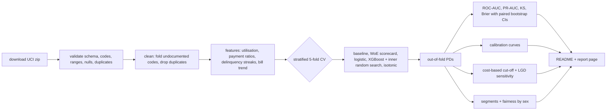
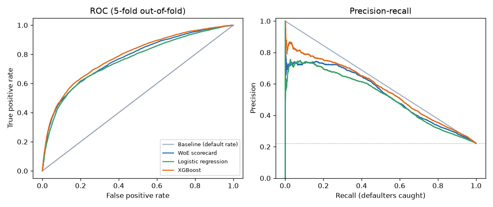
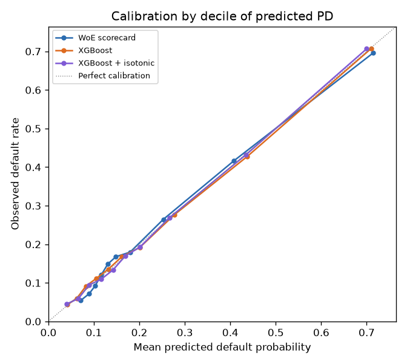
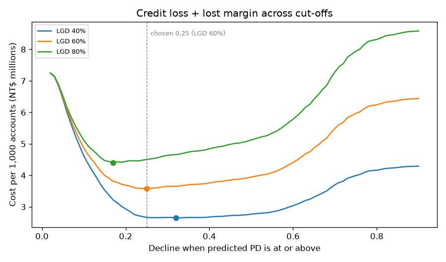
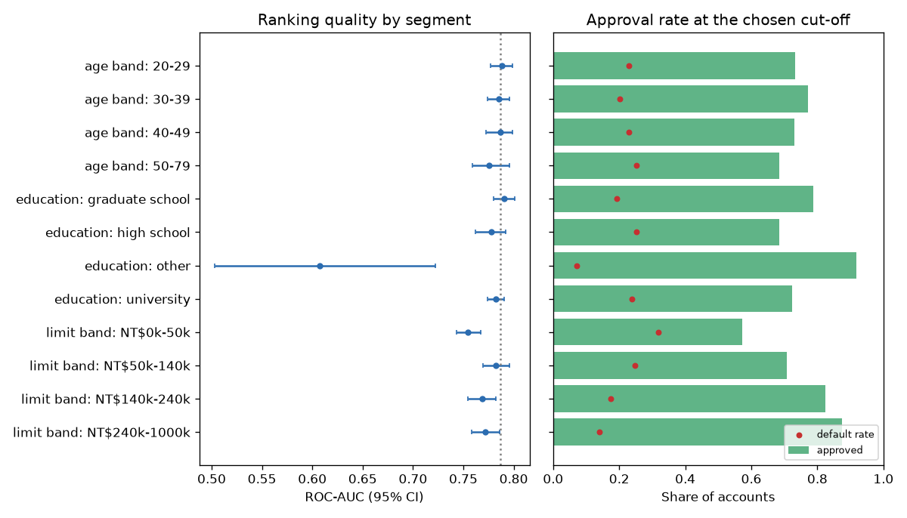
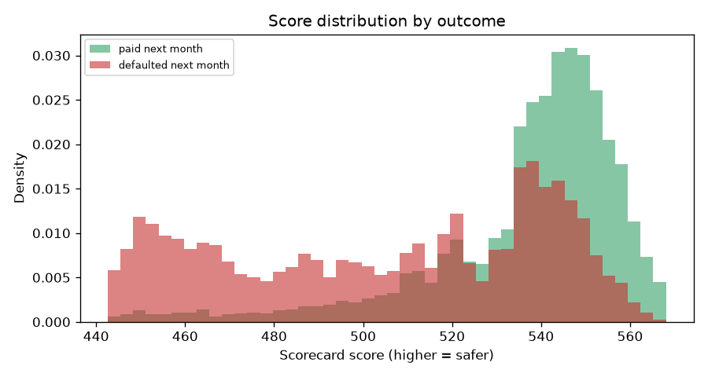
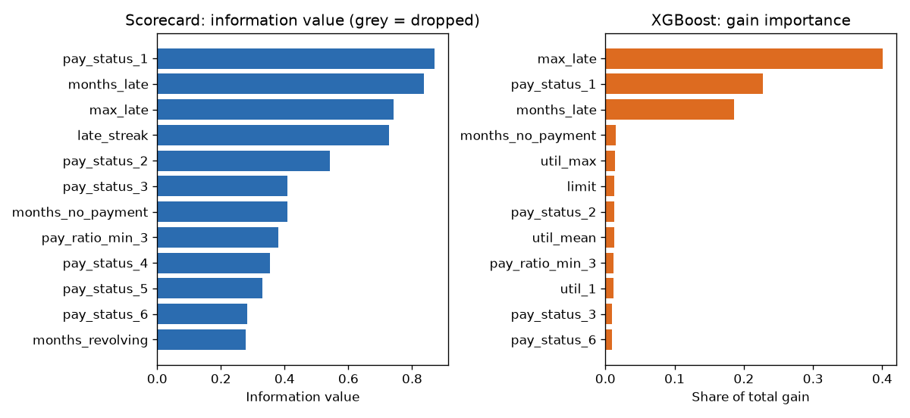

# Credit Card Default Risk Scorecard

[](https://github.com/teozkose/credit-default-risk/actions/workflows/ci.yml)

[](LICENSE)

## TL;DR

- **Question:** which credit card accounts should keep their credit line open next year, and does a black-box model earn its place over a points-based scorecard?
- **Headline:** on 29,965 accounts, tuned XGBoost ranks next-month defaulters with ROC-AUC **0.787** (95% CI 0.780–0.793), 0.015 above a WoE scorecard. Declining accounts with a calibrated default probability of 0.25 or more cuts credit loss plus lost margin by **45%** against keeping every line open (NT$2,880k per 1,000 accounts, 95% CI NT$2,685k–NT$3,080k).
- **Decision:** deploy the scorecard. At their own best cut-offs the two models cost the same within noise (NT$3,039 per 1,000 accounts, 95% CI -NT$52k to NT$53k), and the scorecard is a 90-row points table that a credit officer can read and explain to a customer.

## Problem and decision

A card issuer reviews its book before the next cycle: keep each account's line open, or freeze it and collect the balance. Keeping a line open for an account that defaults loses part of the balance; closing a good account gives up the interest and fees it would have paid. The risk team needs a probability of default (PD) it can trust, a cut-off that balances the two costs, and evidence that the rule treats customer groups consistently. The deciding metrics are ROC-AUC and KS for ranking, Brier score and calibration error for the probabilities, and expected cost per 1,000 accounts for the cut-off.

## Data

- **Source:** [Default of Credit Card Clients](https://archive.ics.uci.edu/dataset/350/default+of+credit+card+clients), UCI Machine Learning Repository (Yeh and Lien, 2009), CC BY 4.0. One 5.5 MB zip holding an `.xls` file, downloaded by `make data` and never committed.
- **Size and range:** 30,000 accounts of a Taiwanese bank, six monthly statements from April to September 2005, target = missed payment in October 2005 (default rate 22.1%). Credit limits NT$10,000 to NT$1,000,000, ages 21 to 79.
- **Fields:** credit limit, sex, education, marital status, age; for each of six months the repayment status (-2 no balance, -1 paid in full, 0 revolving, 1-9 months late), the bill amount and the amount paid. The source names the latest status `PAY_0` but the matching bill `BILL_AMT1`; the code renames it to `pay_status_1` so every month shares one index.
- **Validation** (`src/credit/validate.py`): required columns, no nulls, unique ids, allowed codes for sex, education, marriage and target, repayment status in [-2, 9], non-negative payments, plausible limits and ages. Any failure stops the run with the full list. Values the documentation does not mention are counted, not rejected: 345 education codes 0, 5 or 6, 54 marital status 0, and 3,932 negative monthly bills (credit balances, kept as they are).
- **Cleaning** (counts from the last run):

| Step | Rows in | Values changed | Rows dropped | Rows out |
|---|---|---|---|---|
| Fold undocumented EDUCATION codes 0, 5, 6 into 4 (other) | 30,000 | 345 | 0 | 30,000 |
| Fold undocumented MARRIAGE code 0 into 3 (other) | 30,000 | 54 | 0 | 30,000 |
| Drop accounts identical on every field except the id | 30,000 | 0 | 35 | 29,965 |

## Approach



- **Features** (`src/credit/features.py`): balance-to-limit utilisation (latest, mean, max over six months), share of last month's bill paid (latest, mean, worst of three), months late, worst lateness, current late streak, months revolving, months with an unpaid bill and no payment, bill trend (least-squares slope over six months, scaled by the limit) and three-month balance change. Sex and marital status are never model inputs; sex is kept only for the fairness check.
- **Validation:** stratified 5-fold cross-validation over accounts; every reported number is out-of-fold. XGBoost hyperparameters come from an 8-draw random search scored by 3-fold inner CV on each training fold, and the isotonic map is fitted on inner folds too, so no prediction ever comes from a model that saw that account.
- **Models:** a baseline that gives everyone the training default rate (the probabilistic version of "always predict no default"); a weight-of-evidence scorecard (quantile bins, small bins merged, features with information value below 0.02 dropped, logistic regression on the WoE values, scaled to 600 points at 50:1 odds with 20 points to double the odds); L2 logistic regression on standardised raw features; tuned XGBoost; and XGBoost with isotonic recalibration.
- **Uncertainty:** 1,000 bootstrap resamples of accounts, shared across models so differences are paired. The resamples are applied as integer weights to scores sorted once, which makes 5,000 metric evaluations take seconds.
- **Decision rule:** keep the line open when PD is below a cut-off. Cost = LGD × balance for every approved defaulter + margin × balance for every declined good account (LGD 60%, margin 18% of the balance over 12 months, balance floored at NT$1,000). The cut-off is swept from 0.02 to 0.90.
- **Sensitivity check:** the cut-off is recomputed at LGD 40%, 60% and 80%.

## Results

Out-of-fold over 29,965 accounts ("Calib. error" is the count-weighted gap between predicted and observed default rate over PD deciles; "Fold SD" is the standard deviation of ROC-AUC across the five folds):

| Model | ROC-AUC (95% CI) | PR-AUC (95% CI) | KS | Brier | Calib. error | Fold SD |
|---|---|---|---|---|---|---|
| Baseline: everyone gets the average default rate | 0.500 (0.500–0.500) | 0.221 (0.216–0.225) | 0.000 | 0.1723 | 0.0000 | 0.000 |
| WoE logistic scorecard | 0.772 (0.765–0.778) | 0.534 (0.521–0.547) | 0.417 | 0.1363 | 0.0125 | 0.007 |
| Logistic regression (raw features) | 0.758 (0.752–0.765) | 0.516 (0.502–0.528) | 0.411 | 0.1396 | 0.0077 | 0.011 |
| XGBoost (tuned) | 0.787 (0.780–0.793) | 0.562 (0.549–0.575) | 0.436 | 0.1332 | 0.0051 | 0.008 |
| XGBoost + isotonic recalibration | 0.787 (0.780–0.793) | 0.562 (0.548–0.574) | 0.436 | 0.1333 | 0.0053 | 0.008 |

XGBoost beats the scorecard by 0.015 ROC-AUC (paired 95% CI 0.012–0.018) and plain logistic regression by 0.028. Both scorecard and logistic regression are linear in their inputs; the scorecard's edge comes from its WoE bins, which let one coefficient per feature fit a non-linear step such as the one from "paid in full" to "one month late", where the raw status code gets a single straight-line slope.



**Calibration.** XGBoost trained on log-loss is already close to calibrated (calibration error 0.0051). Isotonic recalibration leaves it at 0.0053, and the Brier score changes from 0.1332 to 0.1333, a difference whose 95% CI (-0.0001–0.0003) includes zero. The recalibrated model is still the one used for the cut-off, because the cut-off rule assumes calibrated PDs and isotonic is the safeguard if retraining drifts. The scorecard's error is 0.0125.



**The cut-off.** Approving everyone costs NT$6,465k per 1,000 accounts. Declining accounts with PD ≥ 0.25 keeps 74.2% of lines open and brings the cost to NT$3,584k, a 45% cut. Theory says that with calibrated PDs the best cut-off is margin / (LGD + margin) = 0.231, whatever the balance; the empirical sweep lands next to it. The scorecard, with its own best cut-off of 0.28 (78.1% approved), saves 45%: XGBoost is cheaper in only 46% of bootstrap resamples. Better ranking overall does not turn into a cheaper decision at this one cut-off.



**Sensitivity to LGD.** The cut-off moves from 0.32 at 40% LGD (79.2% approved) to 0.17 at 80% (55.2% approved). Keeping the 60% cut-off when the true LGD is 40% or 80% costs only NT$13k or NT$105k extra per 1,000 accounts, because the cost curve is flat near its minimum:

| LGD | Best cut-off | Theory | Approved | Saving / 1,000 accts | Saving % | Cost of keeping the 60% cut-off |
|---|---|---|---|---|---|---|
| 40% | 0.32 | 0.31 | 79.2% | NT$1,658k | 38.5% | NT$13k |
| 60% | 0.25 | 0.23 | 74.2% | NT$2,880k | 44.6% | NT$0 |
| 80% | 0.17 | 0.18 | 55.2% | NT$4,221k | 49.0% | NT$105k |

## What drives it / error analysis

- **Payment history dominates.** Highest information value: pay_status_1 (0.87), months_late (0.84), max_late (0.74), late_streak (0.73). XGBoost puts 81% of its total gain on max_late (40%), pay_status_1 (23%), months_late (19%). Utilisation and payment ratios add a little on top; the scorecard keeps 20 of 22 candidate features and drops age, education for IV below 0.02.
- **Segments.** Ranking quality is stable across age and education bands. It is weakest for the smallest limits (ROC-AUC 0.755 at NT$0-50k), which also have the highest default rate (31.8%), so only 57.3% of those accounts are approved against 87.5% above NT$240k. The "other" education group (468 accounts, mostly the undocumented codes) has ROC-AUC 0.607 with a wide CI: too few defaulters to judge.

| Segment | Level | Accounts | Default rate | Mean PD | ROC-AUC (95% CI) | Approved |
|---|---|---|---|---|---|---|
| Age | 20-29 | 9,603 | 22.9% | 23.0% | 0.788 (0.777–0.799) | 73.2% |
| Age | 30-39 | 11,226 | 20.3% | 20.4% | 0.785 (0.774–0.796) | 77.2% |
| Age | 40-49 | 6,456 | 22.9% | 22.9% | 0.787 (0.773–0.799) | 73.1% |
| Age | 50-79 | 2,680 | 25.3% | 25.6% | 0.776 (0.759–0.795) | 68.4% |
| Education | graduate school | 10,563 | 19.2% | 19.4% | 0.791 (0.780–0.801) | 78.8% |
| Education | high school | 4,915 | 25.2% | 25.1% | 0.778 (0.762–0.792) | 68.4% |
| Education | other | 468 | 7.1% | 11.9% | 0.607 (0.503–0.722) | 91.9% |
| Education | university | 14,019 | 23.7% | 23.7% | 0.783 (0.774–0.791) | 72.3% |
| Credit limit | NT$0k-50k | 7,673 | 31.8% | 31.8% | 0.755 (0.743–0.767) | 57.3% |
| Credit limit | NT$50k-140k | 7,607 | 24.7% | 24.6% | 0.782 (0.770–0.796) | 70.8% |
| Credit limit | NT$140k-240k | 7,627 | 17.4% | 17.6% | 0.769 (0.755–0.782) | 82.4% |
| Credit limit | NT$240k-1000k | 7,058 | 14.0% | 14.3% | 0.772 (0.758–0.786) | 87.5% |



- **Fairness check by sex.** Sex is not a model input, but other features can stand in for it, so outcomes are compared after the fact. Men in this sample default more often (24.2% vs 20.8%), and the model's mean PD tracks that closely (23.6% vs 21.4%), so it is calibrated within each group. As a result men are approved less often (71.7% vs 75.9%). Among accounts that went on to pay, 17.8% of men and 15.1% of women would have been declined; among accounts that defaulted, 38.9% of men and 41.5% of women would have been approved. In plain terms: the rule does not penalise either group beyond its observed repayment record, but a good-paying man is slightly more likely to be turned down than a good-paying woman. A lender would review that gap against its fair-lending policy before deployment.

| Group | Accounts | Default rate | Mean PD | Approved | Good accounts declined | Defaulters approved |
|---|---|---|---|---|---|---|
| female | 18,091 | 20.8% | 21.4% | 75.9% | 15.1% | 41.5% |
| male | 11,874 | 24.2% | 23.6% | 71.7% | 17.8% | 38.9% |

- **The scorecard itself.** Scores run from about 445 to 567 (1st to 99th percentile); the median account that defaulted scores 511 against 543 for one that paid. The first three features of the points table (full table in `results/scorecard_points.csv`):

| Feature | Bin | Accounts | Default rate | WoE | Points |
|---|---|---|---|---|---|
| pay_status_1 | (-inf, -1] | 8,432 | 15.6% | +0.43 | 37 |
| pay_status_1 | (-1, 0] | 14,737 | 12.8% | +0.66 | 43 |
| pay_status_1 | (0, 1] | 3,667 | 34.0% | -0.60 | 11 |
| pay_status_1 | (1, inf] | 3,129 | 69.5% | -2.08 | -28 |
| months_late | (-inf, 0] | 19,918 | 11.7% | +0.76 | 31 |
| months_late | (0, 1] | 4,405 | 29.9% | -0.41 | 23 |
| months_late | (1, 2] | 1,899 | 38.8% | -0.80 | 21 |
| months_late | (2, inf] | 3,743 | 60.0% | -1.66 | 15 |
| max_late | (-inf, 0] | 19,918 | 11.7% | +0.76 | 26 |
| max_late | (0, 1] | 1,668 | 25.1% | -0.16 | 26 |
| max_late | (1, inf] | 8,379 | 46.3% | -1.11 | 27 |





## Limitations and next steps

- **The label is a missed payment, not a loss.** LGD and margin are assumptions applied to the latest balance, so the NT$ figures show the shape of the trade-off, not a bank's P&L. With real recovery data, LGD would be modelled per account.
- **One bank, six months, one unusual year.** The data come from 2005, during Taiwan's card-debt crisis, and the 22.1% default rate is far above normal. The cut-off would need refitting on current data.
- **No out-of-time test.** All accounts share the same observation window, so cross-validation is random over accounts. A later cohort is the right test for drift.
- **Fairness check is narrow.** One attribute and outcome rates only. Next: adverse-action reasons from the points table, and a check of which features stand in for sex.
- **Next steps:** monotonic WoE bins (now bins only need a minimum size), a reject-inference note, and a challenger test that runs the scorecard and XGBoost side by side on new accounts.

## Reproduce

```bash
python -m venv .venv && source .venv/bin/activate
pip install -r requirements.txt -r requirements-dev.txt
make all     # data -> features -> run -> report -> notebook (about 2 min on a laptop)
make test    # 8+ tests on synthetic accounts, no download
make lint
```

`run_all.sh` runs the same steps. Every number above is filled in from `results/metrics.json` by `src/credit/report.py`, which also writes the report page in `docs/index.html`. `xlrd` is the one library outside the usual stack: the source file is a legacy `.xls`.

## Project structure

```
credit-default-risk/
├── config.yaml              # paths, cleaning rules, model and decision parameters
├── Makefile / run_all.sh    # make data | run | report | all
├── data/download.py         # fetches the UCI zip (data files are not committed)
├── src/credit/
│   ├── data.py              # download, read the .xls, tidy column names
│   ├── validate.py          # schema, codes, ranges, nulls, duplicates
│   ├── features.py          # cleaning log + account-level features
│   ├── woe.py               # WoE binning, information value, points table
│   ├── models.py            # baseline, scorecard, logistic, XGBoost search, isotonic
│   ├── evaluate.py          # weighted-bootstrap metrics, calibration, segments
│   ├── decision.py          # cost-based cut-off, sensitivity, fairness table
│   ├── figures.py           # all charts
│   ├── report.py            # README + docs/index.html from metrics.json
│   └── pipeline.py          # stages and the cross-validation loop
├── tests/                   # synthetic-data tests, incl. an end-to-end run
├── notebooks/01_analysis.ipynb
├── results/                 # metrics.json, scorecard_points.csv, figures
└── docs/index.html          # report page
```

Licence: MIT for the code. Data: CC BY 4.0, Yeh, I. C., and Lien, C. H. (2009), *The comparisons of data mining techniques for the predictive accuracy of probability of default of credit card clients*, Expert Systems with Applications 36(2).
